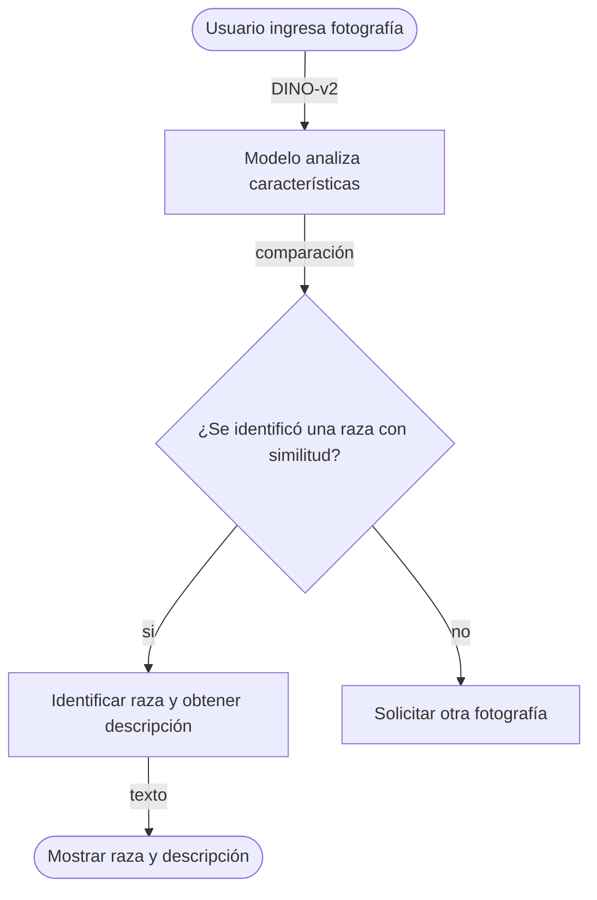

# Identificador de razas de perros y gatos

>   Identificar la raza del perro o gato a partir de una comparación de dos imágenes.

**Proyecto integrador · Herramientas de IA**
**Grupo:** A1 · **Equipo:** 4
## 👥 Integrantes

| Nombre completo                 | Matrícula |
| ------------------------------- | --------- |
| Pablo Israel Ávalos Moreno      | 198642-8  |
| Héctor Ulises Serrano Ramos     | 198436-4  |
| María Isabella Rangel Gutiérrez | 198102-8  |
| Jessica Abigail Tovar Solís     | 198078-6  |

## 1. Caso de uso

**Necesidad:** Identificar la raza de un perro mediante una fotografía digital de su cara o cuerpo completo, devolviendo la raza correspondiente y su descripción.

**¿De quién?:** Del usuario que sube la imagen del animal para conocer o verificar su raza.

  - **Entrada:** El usuario proporciona una fotografía en formato digital de la cara o cuerpo completo del animal que se quiere conocer la raza.
  - **Salida:**  El sistema genera un vector de características y devuelve la raza de acuerdo a las similitudes encontradas.
 
## 🔀 Cómo funciona

## 2. Modelo abierto elegido

| Dato                         | Respuesta                                                                                                                                                                                                |
| ---------------------------- | -------------------------------------------------------------------------------------------------------------------------------------------------------------------------------------------------------- |
| Identificador                | [AvitoTech/DINO-v2-small-for-animal-identification](https://huggingface.co/AvitoTech/SigLIP2-Base-for-animal-identification )                                                                            |
| Tarea (pipeline tag)         | ` image-feature-extraction ` (Extracción de Embeddings para Re-identificación)                                                                                                                           |
| Número de parámetros         | 22.1 M                                                                                                                                                                                                   |
| Licencia                     | Apache 2.0                                                                                                                                                                                               |
| Limitación o sesgo declarado | Disminución en la precisión de identificación cuando las fotografías presentan iluminación deficiente, ángulos muy inclinados o cuando el rostro/cuerpo de la mascota se encuentra parcialmente ocluido. |

## 3. Viabilidad de hardware
  $$

\text{Memoria mínima} = N \times 4\ \text{bytes} \approx \ ?\ \text{GB}

$$
$$

\text{Memoria mínima} = 22,100,000 \times 4\ \text{bytes} \approx 88,400,000\ \text{GB}

$$

- **VRAM disponible en Colab:** 12.67 GB (GPU T4)
- **Dónde se ejecuta:** Colab con GPU
- **Por qué:**  El modelo requiere únicamente ~88.4 MB, lo que representa menos del 5% de la VRAM asignada por Colab. Esto garantiza una inferencia rápida y local sin exceder los recursos del entorno gratuito ni depender de cuotas de una API externa.

## 4. Riesgo ético

- **Riesgo:** Posible error en la comparación de imágenes, y a futuro, pueden existir riesgos mayores debido al uso de datos personales.

- **Mitigación:** Para nuestro riesgo actual (comparación falsa) podemos definir de manera más precisa los parámetros de las comparaciones.

## 5. Evidencia

![[Captura de pantalla 2026-09-24 102403.png]]

